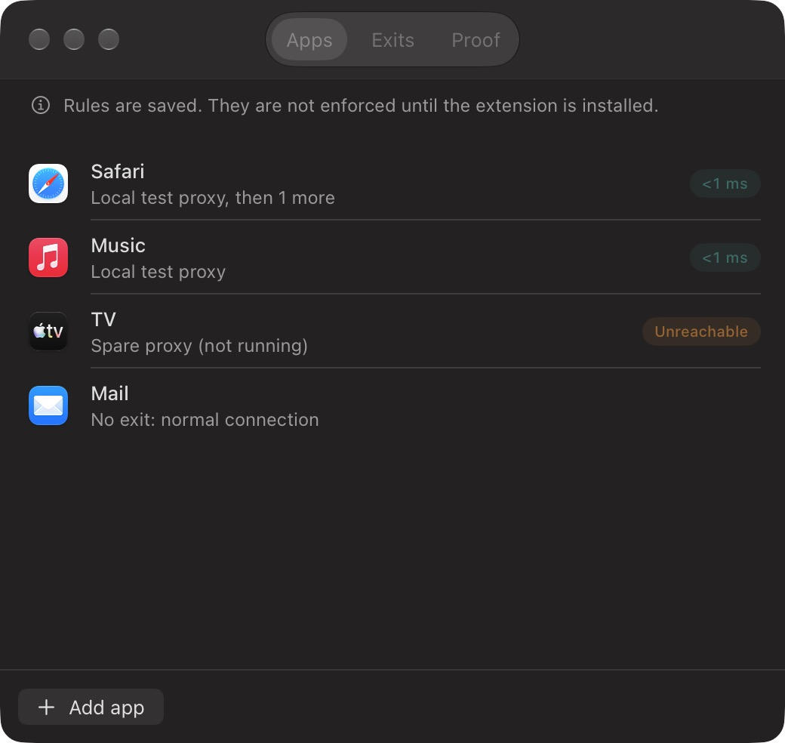
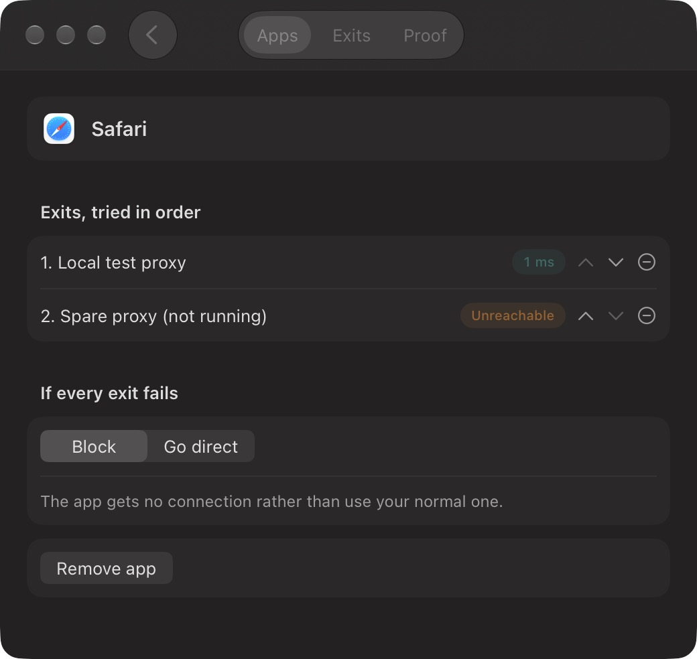
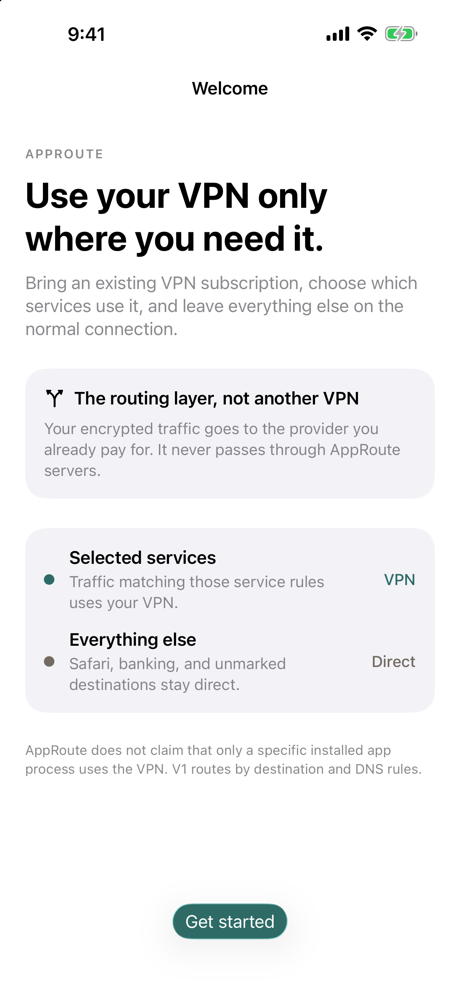
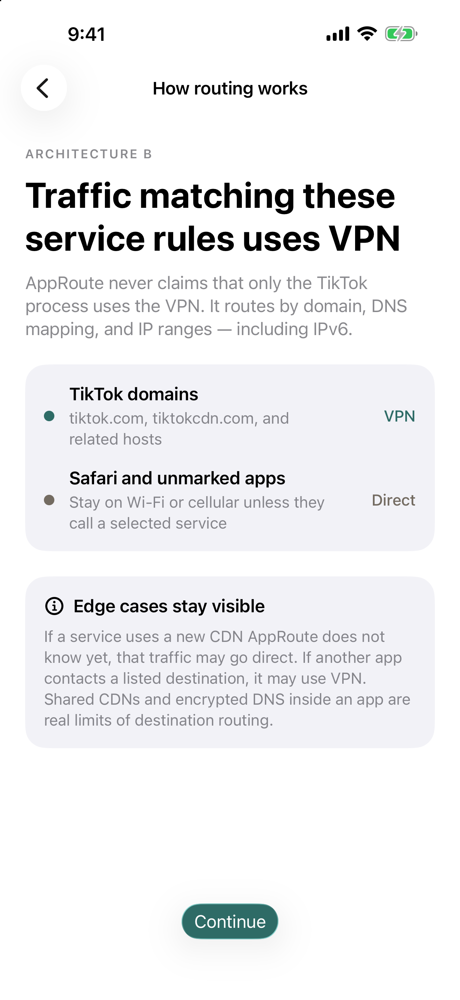
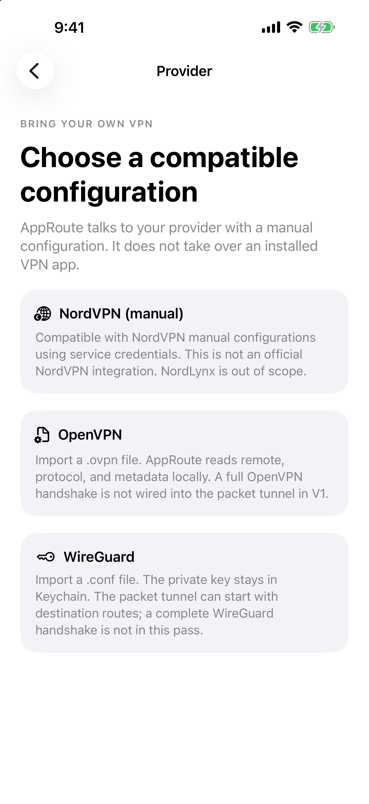
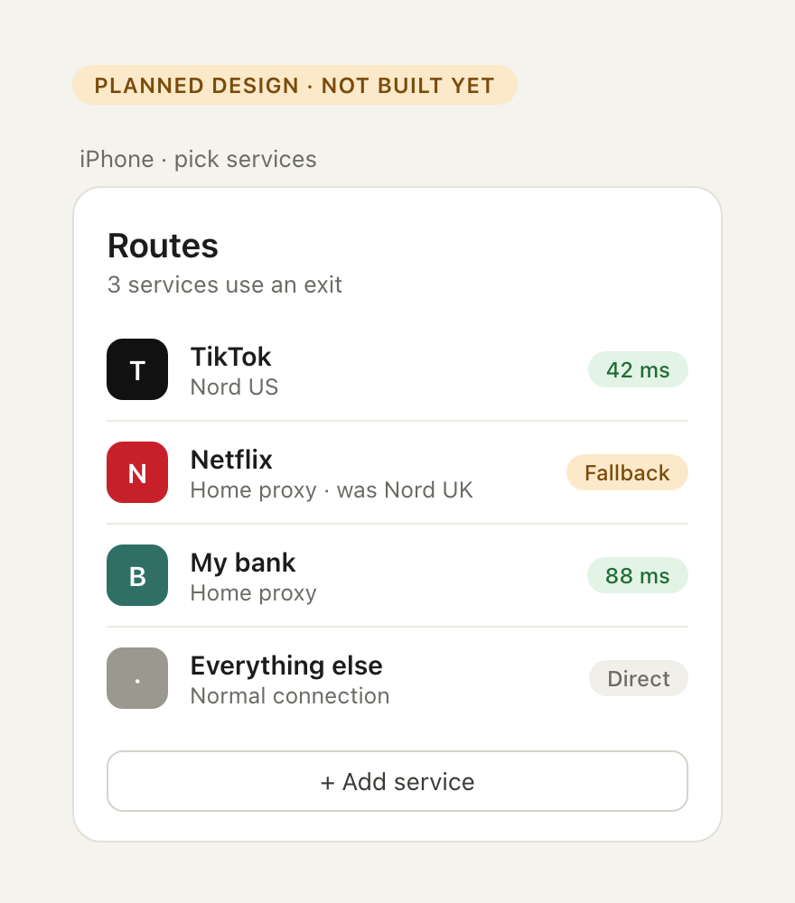

# AppRoute

Send only the apps you choose through a VPN or proxy you already have. Everything else stays on your normal connection.

**Status: early and unfinished.** Nothing here is ready to install. The Mac proof compiles but has not been run signed yet, and the iPhone app is an interface without a working tunnel. See [What works today](#what-works-today).

## Why

A VPN is normally all or nothing: turn it on and every app goes through it, including the ones that break or slow down. AppRoute is meant to let you say "this app uses this exit" and leave the rest alone, with a second exit to fall back to when the first one is slow or down.

## What each platform can do

| | Mac | iPhone |
|---|---|---|
| Route by real app | Yes. macOS hands a transparent proxy each connection together with the app that made it. | No. Apple allows per-app VPN only for apps installed through device management (MDM). |
| What you pick | An installed app | A service, matched by its domains and IP ranges |
| Known leaks | An app's helper processes have to be mapped to it | Another app that contacts the same domains also uses the exit |

The Mac app is being built first because it can keep the promise exactly.

## Screenshots

Mac app, real captures from an unsigned build. The rules shown are saved but **not enforced yet**: enforcing them needs the system extension, which has not been run.

<p>


</p>

The exits in these captures are local test proxies on `127.0.0.1`. Connect time is how long a TCP handshake with the exit takes.

iPhone app (interface only):

<p>



</p>

Planned iPhone screen. A design mockup, not a screenshot; it does not exist yet.



## What works today

**Mac (`AppRouteMac`, `AppRouteProxy`)**

- A system extension (`NETransparentProxyProvider`) claims outbound TCP and UDP.
- Connections made by `curl` (signing identifier `com.apple.curl`, hard-coded) are relayed through one SOCKS5 exit with no authentication. `curl`'s UDP is refused so QUIC cannot leave from your real address. Every other connection is handed back to the system untouched.
- Both targets compile with no warnings. **The extension has not been run yet**, so none of the routing is verified on a live system.
- The app lists installed apps, lets you assign each one SOCKS5 exits in order, choose what happens if every exit fails, and shows a measured connect time per exit. These rules are saved to disk and survive a relaunch. The extension does not read them yet.
- Not built yet: enforcing the rules, mapping helper processes to their app, credentials, switching exits on failure, WireGuard. DNS still resolves locally.

**iPhone (`AppRoute`, `AppRouteTunnel`)**

- Onboarding, provider and service screens, rule matching, WireGuard and OpenVPN config parsers, and unit tests for those.
- The packet tunnel installs routes but **does not forward traffic**. The only path that connects is NordVPN manual IKEv2, which is a full-device VPN.
- The subscription screens are left over from an earlier direction and will be removed.

## Roadmap

1. Run the Mac proof signed: `curl` exits through the proxy while Safari does not.
2. Have the extension enforce the saved rules; helper-to-app mapping; credentials in the Keychain.
3. Health checks and automatic fallback between an app's exits.
4. WireGuard exit.
5. Signed, notarised Mac release.
6. iPhone companion that routes by service.

## Build

Requires Xcode 26 or later and [XcodeGen](https://github.com/yonaskolb/XcodeGen).

```bash
xcodegen generate
```

Compile the Mac targets without signing:

```bash
xcodebuild -scheme AppRouteMac -configuration Debug CODE_SIGNING_ALLOWED=NO build
```

Compile the iPhone app for the simulator:

```bash
xcodebuild -scheme AppRoute -destination 'generic/platform=iOS Simulator' CODE_SIGNING_ALLOWED=NO build
```

### Running the Mac extension

Running it needs a paid Apple Developer membership, because the Network Extension and System Extension entitlements are not available to free teams. Change the bundle identifiers in `project.yml` to ones your team owns, then pass your team ID:

```bash
DEVELOPMENT_TEAM=ABCDE12345 scripts/run-mac.sh
```

The script builds, copies the app to `/Applications` (macOS loads system extensions only from there) and launches it. Approve the extension under System Settings > General > Login Items & Extensions > Network Extensions.

`scripts/socks5-log.py` is a small SOCKS5 server that prints each connection it carries, for checking which apps reach the exit:

```bash
python3 scripts/socks5-log.py 1080
```

## Privacy

AppRoute runs no servers. Traffic goes from your device to the exit you configure. It keeps no browsing history, DNS logs or packet contents.
